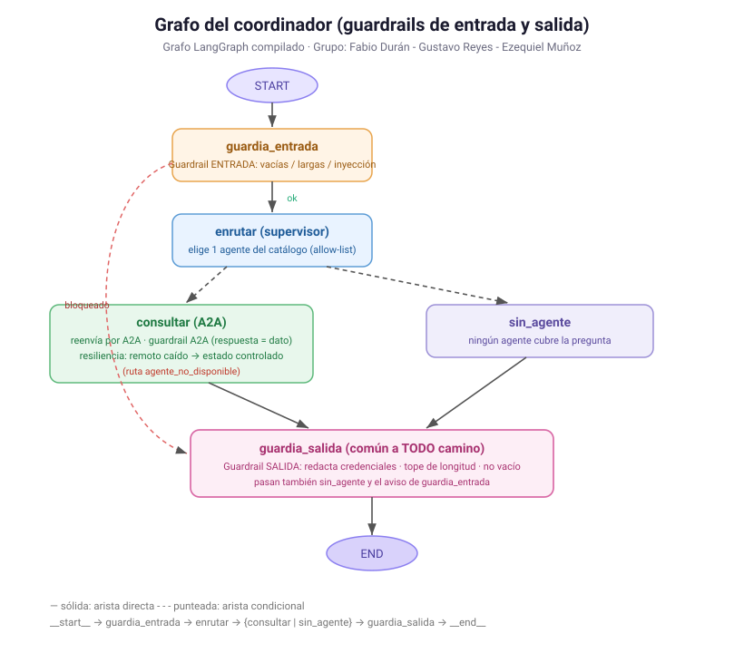
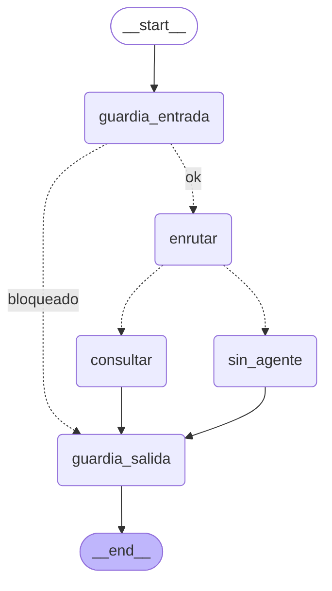
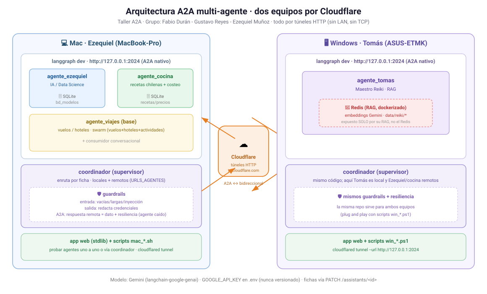

<!--encabezado-grupo-->
> **Archivo:** `evidencias/09-diagramas.md`  
> **Objetivo:** Diagramas · grafo del coordinador y arquitectura de agentes  
> **Grupo del curso:** Fabio Durán - Gustavo Reyes - Ezequiel Muñoz  
> **Creación:** 20261111 0743 · **Última modificación:** 20261111 1857
<!--/encabezado-grupo-->

# Diagramas · grafo del coordinador y arquitectura de agentes

Evidencia visual (prompt 46). Los SVG se ven en GitHub y en cualquier navegador.

## 1. Grafo del coordinador

Grafo LangGraph compilado (auténtico, `graph.get_graph().draw_mermaid()`):

- `guardia_entrada`: guardrail de ENTRADA (vacías/largas/inyección); si bloquea, va directo a END.
- `enrutar`: el supervisor elige un agente del catálogo por su ficha.
- `consultar`: reenvía por A2A; guardrail A2A (respuesta = dato); si el remoto cae → estado controlado (`agente_no_disponible`).
- `guardia_salida`: guardrail de SALIDA común a todo camino (redacta credenciales, tope de longitud, no vacío).
- `sin_agente`: ningún agente cubre la pregunta.

## 2. Arquitectura de los agentes (dos equipos por Cloudflare)

- **Mac · Ezequiel**: `agente_ezequiel` (SQLite modelos), `agente_cocina` (SQLite recetas),
  `agente_viajes`/swarm/consumidor; coordinador con guardrails; app web.
- **Windows · Tomás**: `agente_tomas` (RAG sobre Redis dockerizado); mismo coordinador.
- **Cloudflare**: túneles HTTP (trycloudflare.com); A2A bidireccional, sin LAN ni TCP.
- **Gemini** como modelo; `GOOGLE_API_KEY` en `.env` (nunca versionado).
