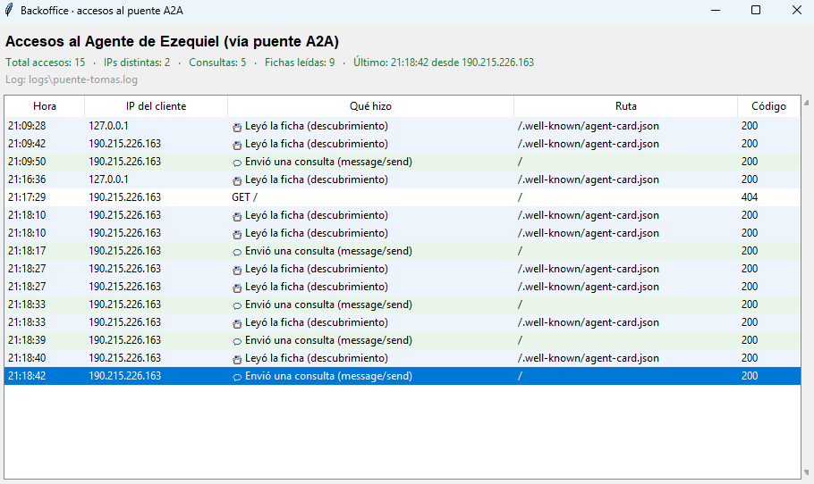

<!--encabezado-grupo-->
> **Archivo:** `evidencias/15-backoffice-tomas-mac.md`  
> **Objetivo:** Backoffice en vivo · el monitor de Tomás ve quién consume su agente  
> **Grupo del curso:** Fabio Durán - Gustavo Reyes - Ezequiel Muñoz  
> **Creación:** 20261111 2120 · **Última modificación:** 20261112 1508
<!--/encabezado-grupo-->

# Backoffice en vivo · el monitor de Tomás ve quién consume su agente

Demostración cruzada del **backoffice** (prompt 50): Tomás levantó en su **Windows** el
puente A2A clásico **delante de `agente_tomas`** y su **monitor Tkinter**
(`tools/monitor_puente.py`), que lee el log de accesos del puente. Desde el **Mac** (Ezequiel)
consumimos su agente por su túnel de Cloudflare y el monitor de Tomás registró, en vivo, cada
acceso (IP del edge de Cloudflare, método, path, código).

## Montaje

- **Windows (Tomás)** — scripts nuevos `scripts/win_puente.ps1` + `scripts/win_fichas_auto.ps1`:
  - `agente_tomas` en `langgraph dev` (:2024), fichas auto-mantenidas (`win_fichas_auto.ps1`).
  - Puente A2A clásico en `:8791` escribiendo `logs\puente-tomas.log` (`win_puente.ps1`).
  - Túnel `cloudflared tunnel --url http://127.0.0.1:8791` → URL pública del puente.
  - Monitor `uv run python tools\monitor_puente.py --log logs\puente-tomas.log`.
- **Mac (Ezequiel)** — cliente A2A generalizado (`src/coordinador/a2a.py`) apuntando a esa URL.

> El puente es necesario porque `langgraph dev` **nativo no escribe** el log de accesos que
> lee el monitor; consumiendo a través del puente clásico, cada petición queda registrada.

## Tráfico generado desde el Mac (en vivo)

Cuatro consultas de Reiki a `agente_tomas`, todas respondidas por el puente (code 200):

| ctx | consulta | respuesta (resumen) |
|---|---|---|
| demo-mac-1 | ¿Qué es el Reiki y cuáles son sus principios? | Rei+Ki; **5 Gokai** (solo por hoy: no te enojes / no te preocupes / sé agradecido / trabaja con honestidad / sé amable) + disclaimer |
| demo-mac-2 | ¿En qué consiste una sesión y cuánto dura? | imposición de manos, presencial o a distancia (símbolos) |
| demo-mac-3 | ¿Diferencia entre Shoden, Okuden y Shinpiden? | N1 físico/autotratamiento · N2 símbolos a distancia/mental-emocional · N3 maestría |
| demo-mac-4 | ¿Reiki reemplaza al tratamiento médico? | **no reemplaza**; acudir a un profesional de la salud |

## Lo que mostró el monitor de Tomás (en vivo)

Resumen del encabezado: **Total accesos 15 · IPs distintas 2 · Consultas 5 · Fichas leídas 9 ·
Último 21:18:42 desde `190.215.226.163`** (log `logs\puente-tomas.log`). Las 2 IPs son el propio
Windows (`127.0.0.1`, pruebas locales) y el **edge de Cloudflare `190.215.226.163`**, por el que
entra todo el tráfico del Mac. Extracto de la tabla:

| Hora | IP | Qué hizo | Ruta | Código |
|---|---|---|---|---|
| 21:09:28 | 127.0.0.1 | Leyó la ficha (descubrimiento) | `/.well-known/agent-card.json` | 200 |
| 21:09:42 | 190.215.226.163 | Leyó la ficha (descubrimiento) | `/.well-known/agent-card.json` | 200 |
| 21:09:50 | 190.215.226.163 | Envió una consulta (message/send) | `/` | 200 |
| 21:16:36 | 127.0.0.1 | Leyó la ficha (descubrimiento) | `/.well-known/agent-card.json` | 200 |
| 21:17:29 | 190.215.226.163 | GET / | `/` | 404 |
| 21:18:17 | 190.215.226.163 | Envió una consulta (message/send) | `/` | 200 |
| 21:18:33 | 190.215.226.163 | Envió una consulta (message/send) | `/` | 200 |
| 21:18:39 | 190.215.226.163 | Envió una consulta (message/send) | `/` | 200 |
| 21:18:42 | 190.215.226.163 | Envió una consulta (message/send) | `/` | 200 |

Las **5 consultas** = 4 del Mac (Reiki) + 1 de prueba del propio Tomás («¿Qué es Shoden?»). Las
**9 fichas leídas** son los GET de descubrimiento (el cliente clásico lee la Agent Card para
resolver el endpoint antes de cada envío). El `404` del `21:17:29` fue un `GET /` suelto (ruta no
servida por el puente): el catch-all responde sin filtrarse.

## Detalle técnico

- **Dialecto:** entró directo por `message/send` (dialecto clásico estándar del puente); el
  cliente **no** necesitó el fallback a `SendMessage` (eso es solo para el SDK de Gustavo).
  Verificable: `a2a._cache_metodo[url]` quedó en `None` (no se aprendió `SendMessage`).
- **Registro sin fugas:** el log guarda metadatos de acceso (timestamp UTC, IP vía
  `Cf-Connecting-Ip`/`X-Forwarded-For`, `"METHOD path"`, código) — **no** el contenido de los
  mensajes ni secretos.

## Lo que demuestra

- **Backoffice operativo cross-machine:** el monitor de Tomás (Windows) ve en tiempo real quién
  consume su agente, incluido el tráfico originado en el Mac.
- **Interoperabilidad A2A clásica** Mac → puente de Windows → `agente_tomas`, con respuestas
  correctas de dominio (Reiki) y disclaimers de seguridad presentes.
- **Automatización:** fichas auto-mantenidas en Windows (`win_fichas_auto.ps1`), sin re-aplicar
  a mano tras cada recarga de `langgraph dev`.

## Nota de implementación

Tras esta prueba se hizo configurable el encabezado del monitor (`tools/monitor_puente.py`,
flag `--titulo` con default desde `PUENTE_GRAFO`): la captura original mostraba "Agente de
Ezequiel" por una etiqueta fija; ahora en el Windows de Tomás refleja su propio agente.
