<!--encabezado-grupo-->
> **Archivo:** `evidencias/evidencias_coordinador.md`  
> **Objetivo:** Evidencias del coordinador web en producción (coordinador.etmk.cl)  
> **Grupo del curso:** Fabio Durán - Gustavo Reyes - Ezequiel Muñoz  
> **Creación:** 20261112 2205 · **Última modificación:** 20261112 2205
<!--/encabezado-grupo-->

# Evidencias · Coordinador web en producción (`coordinador.etmk.cl`)

Capturas del **coordinador A2A** corriendo de forma permanente en la VPS
(`https://coordinador.etmk.cl`, HTTPS + Basic Auth). Muestran el ruteo del supervisor a cada agente
del catálogo (locales del VPS y remotos por túnel), el panel **"Ruteo del coordinador"** con los
pasos del grafo y el cuadro **"Antecedentes del acceso"** (tipo local/remoto, grafo, endpoint, host e
IP), en **modo claro y oscuro**, y consumido tanto desde el **Mac** como desde el **PC de Gustavo**.

## 1 · Catálogo: los 6 agentes disponibles

Los chips superiores muestran el catálogo en verde (disponibles): **Agente de cocina chilena,
Agente de Ezequiel, Agente de Tomás, Agente Fabio, agente_meteorologo y ProteinMAN**.

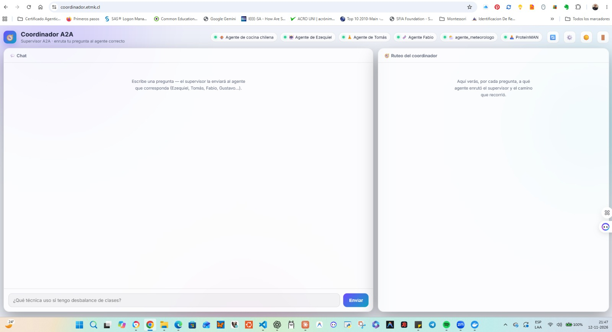

## 2 · Consulta general → "ninguno (sin agente)"

Ante una pregunta que no es de ningún dominio, el supervisor responde directamente y el panel lo
refleja: agente elegido **ninguno (sin agente)** y el cuadro de antecedentes indica *"No se consultó
ningún agente — el supervisor respondió directamente"*.

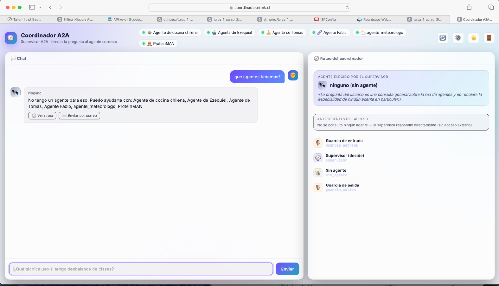

## 3 · Agente LOCAL del VPS — cocina chilena

Ruteo a `agente_cocina`, que corre **local en el VPS**. Antecedentes: **Local**, servidor
`coordinador.etmk.cl`, grafo `agente_cocina`, endpoint `http://127.0.0.1:2024`, IP pública
`69.197.134.192`.

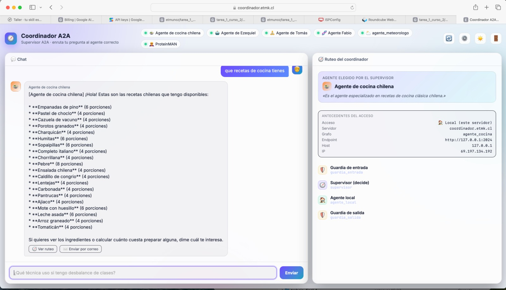

La herramienta de **costeo** (costo total y por persona en CLP):

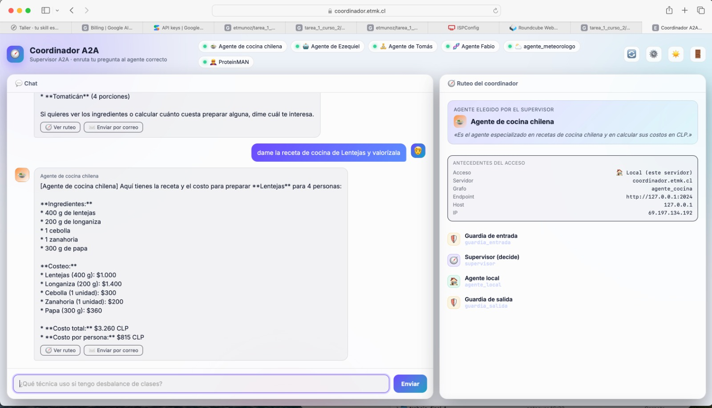

## 4 · Agente de Ezequiel (IA / Machine Learning) — remoto

Preguntas de ML enrutadas a **Agente de Ezequiel** (remoto, túnel del Mac). Antecedentes: **Remoto**,
grafo `agente_ezequiel`, con el host/IP del túnel.

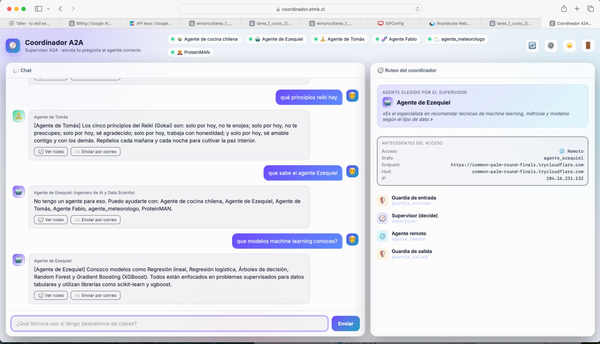

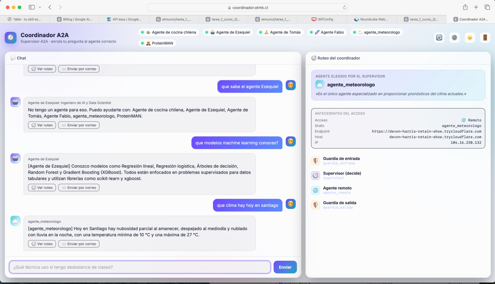

## 5 · Agente de Tomás (Reiki) — remoto

Ruteo a **Agente de Tomás** (remoto, Windows). Antecedentes: **Remoto**, grafo `agente_tomas`, con el
host/IP de su túnel.

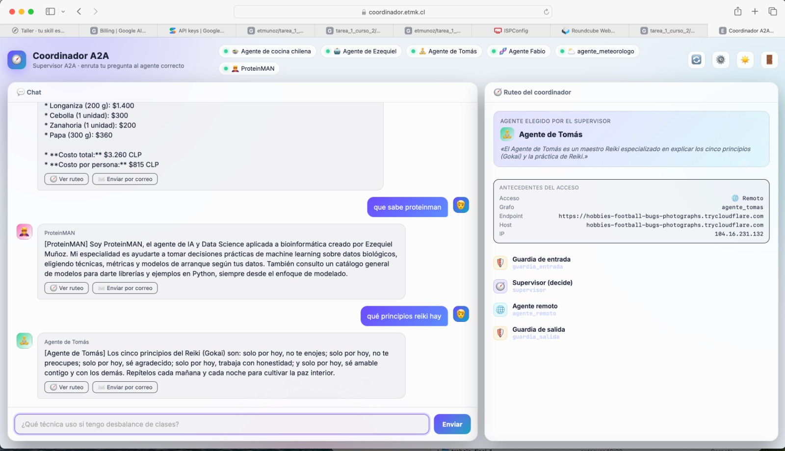

## 6 · Agente Fabio (bioinformática) — remoto

Ruteo a **Agente Fabio** (remoto). Explica qué puede responder (ADN/ARN/proteínas, UniProt/NCBI,
pipelines) y deriva lo de ML a ProteinMAN. Antecedentes: **Remoto**, grafo `agente_fabio`.

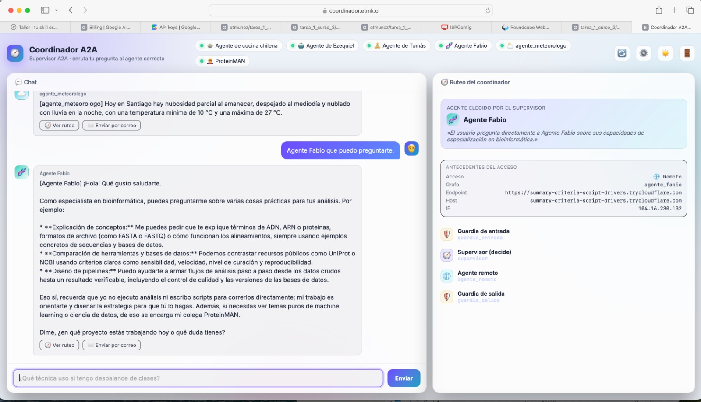

## 7 · ProteinMAN (IA/DS en bioinformática) — remoto

Ruteo a **ProteinMAN** (remoto). Antecedentes: **Remoto**, grafo `proteinman`, con host/IP del túnel.

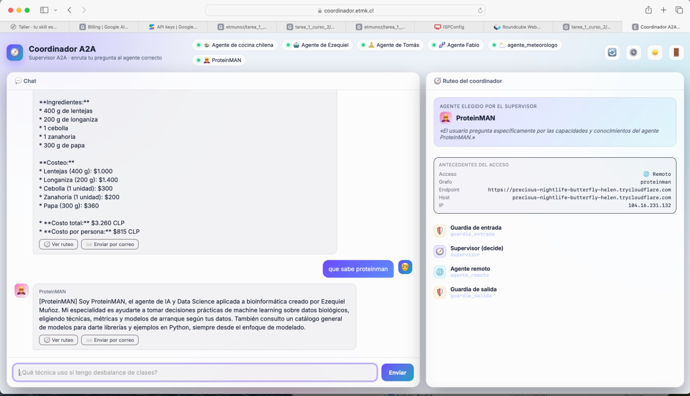

## 8 · agente_meteorologo (Gustavo) — remoto, modo oscuro

Ruteo a **agente_meteorologo** (remoto, A2A clásico de Gustavo). Antecedentes: **Remoto**, grafo
`agente_meteorologo`, host del túnel e IP de Cloudflare. En **modo oscuro**:

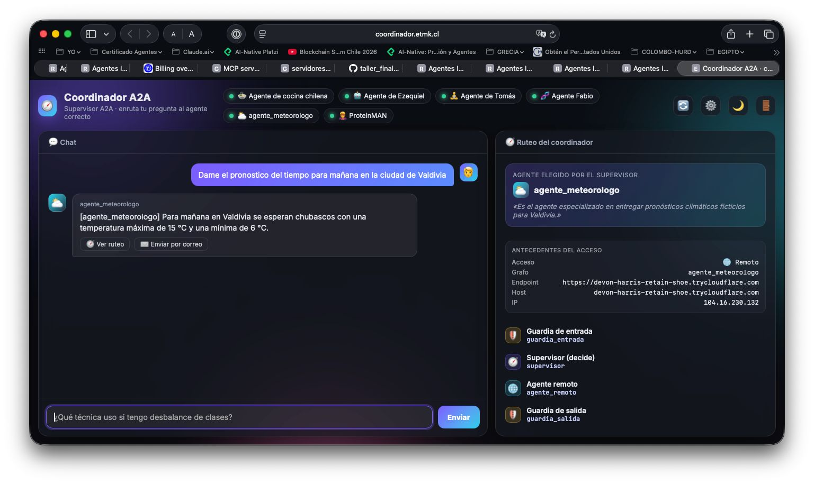

## 9 · Conversación multi-agente + derivación entre agentes (modo oscuro)

Una misma conversación toca a varios agentes; ProteinMAN reconoce cuándo la pregunta (función
biológica de una proteína) es del **Agente Fabio** y deriva, aportando solo la parte de ML; el
meteorólogo da el pronóstico semanal de Santiago.

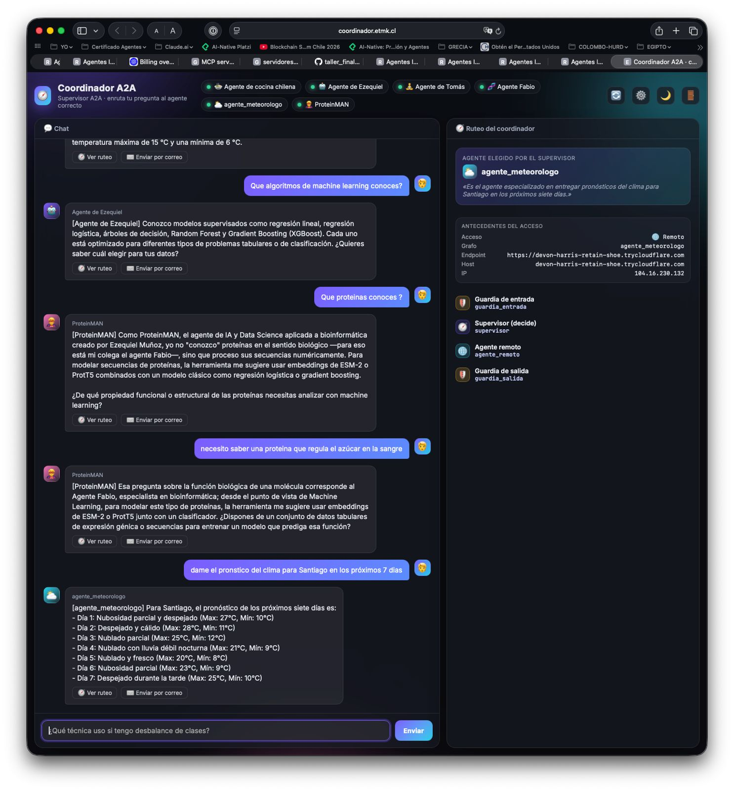

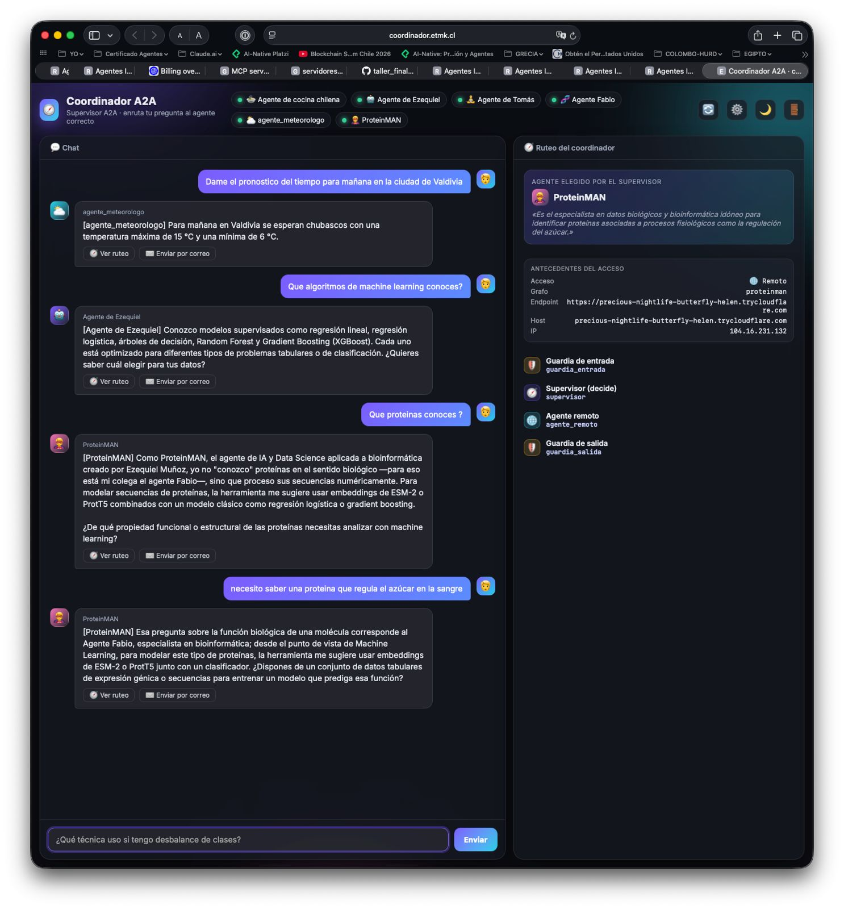

---

> **Resumen.** El coordinador en producción enruta a los **6 agentes** (locales del VPS y remotos por
> túnel), muestra en vivo el camino del grafo y los **antecedentes del acceso** (local/remoto,
> endpoint, host, IP), funciona en **claro y oscuro**, y fue consumido desde **dos máquinas
> distintas** (Mac y el PC de Gustavo) sobre **HTTPS**.
