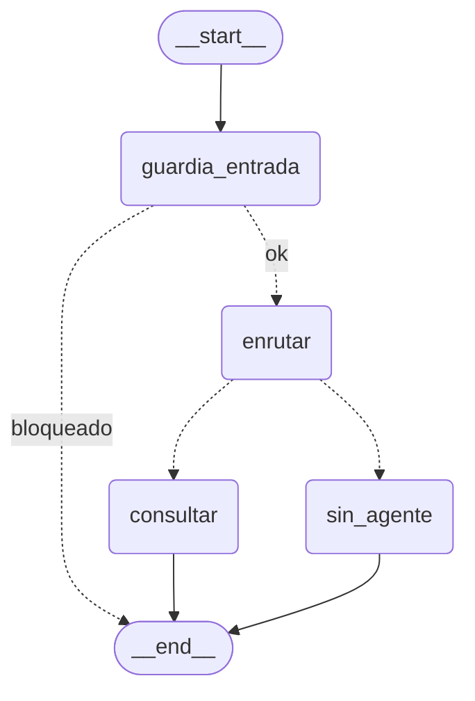

<!--encabezado-grupo-->
> **Archivo:** `respuestas/46-diagramas-grafo-y-arquitectura.md`  
> **Objetivo:** Respuesta 46 · Diagramas: grafo del coordinador y arquitectura de agentes  
> **Grupo del curso:** Fabio Durán - Gustavo Reyes - Ezequiel Muñoz  
> **Creación:** 20261111 0743 · **Última modificación:** 20261111 2049
<!--/encabezado-grupo-->

# Respuesta 46 · Diagramas: grafo del coordinador y arquitectura de agentes

Prompt: [`../prompts_ejecutados/46-diagramas-grafo-y-arquitectura.md`](../prompts_ejecutados/46-diagramas-grafo-y-arquitectura.md)

## Qué se generó (en `evidencias/`)

- **`07-grafo-coordinador.svg`** — grafo del coordinador.
- **`08-arquitectura.svg`** — arquitectura A2A de todos los agentes (2 equipos por Cloudflare).
- **`09-diagramas.md`** — índice con el mermaid auténtico del grafo + enlaces a los SVG.

## Grafo auténtico (desde el grafo LangGraph compilado)

Obtenido con `graph.get_graph().draw_mermaid()`:



- `guardia_entrada`: guardrail de entrada; si bloquea, va directo a `__end__`.
- `enrutar`: supervisor elige un agente por su ficha.
- `consultar`: A2A + guardrails de salida/A2A; si el remoto cae → `agente_no_disponible`.
- `sin_agente`: ningún agente cubre la pregunta.

## Arquitectura (resumen del SVG)

- **Mac · Ezequiel**: `agente_ezequiel` (SQLite modelos), `agente_cocina` (SQLite recetas),
  `agente_viajes`/swarm/consumidor; coordinador con guardrails; app web.
- **Windows · Tomás**: `agente_tomas` (RAG sobre Redis dockerizado); mismo coordinador.
- **Cloudflare**: túneles HTTP; A2A bidireccional, sin LAN ni TCP. Modelo: Gemini.

## Validación y salidas

```text
$ uv run python - <<'PY'
import xml.dom.minidom as m
for f in ["evidencias/07-grafo-coordinador.svg","evidencias/08-arquitectura.svg"]: m.parse(f)
PY
OK evidencias/07-grafo-coordinador.svg
OK evidencias/08-arquitectura.svg

$ uv run python tools/empaquetar_entrega.py --grupo NN
✓ Carpeta de entrega: entrega/tarea_1_curso_2/ (versionada en la repo)
✓ Zip creado: dist/grupo-NN-tarea_1_curso_2.zip  (819889 bytes)
  raíz del zip: tarea_1_curso_2/ · proyecto/: 231 archivos versionados
```

Ambos diagramas se mostraron al usuario (SVG renderizados) y quedaron en la entrega.

## Commits (dos ciclos, como se pidió)

- `84e7020` — «46 · Diagramas: grafo del coordinador y arquitectura de agentes».
- `7e71781` — «46 · Entrega regenerada con los diagramas (grafo + arquitectura)».
