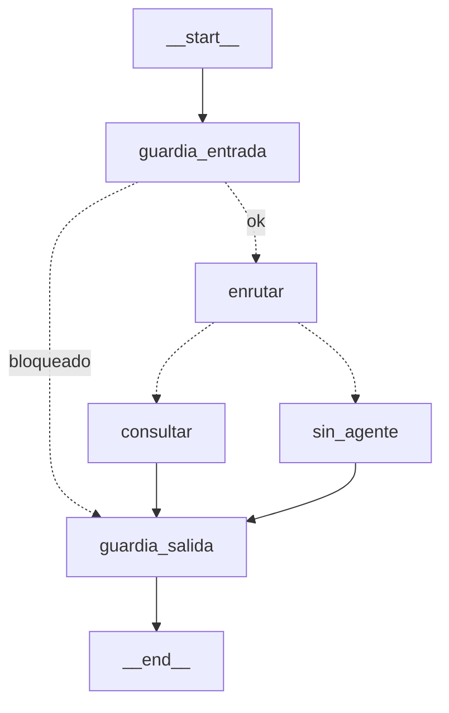

<!--encabezado-grupo-->
> **Archivo:** `respuestas/47-guardrail-salida-y-allowlist.md`  
> **Objetivo:** Respuesta 47 · Guardrail de salida completo + allow-list de agentes  
> **Grupo del curso:** Fabio Durán - Gustavo Reyes - Ezequiel Muñoz  
> **Creación:** 20261111 1204 · **Última modificación:** 20261111 1224
<!--/encabezado-grupo-->

# Respuesta 47 · Guardrail de salida completo + allow-list de agentes

Prompt: [`../prompts_ejecutados/47-guardrail-salida-y-allowlist.md`](../prompts_ejecutados/47-guardrail-salida-y-allowlist.md)

## 1. Guardrail de SALIDA común (`guardia_salida`)

- **`guardrails.revisar_salida(texto)`**: redacta credenciales (reusa `redactar_secretos`),
  trunca si supera `GUARDRAIL_MAX_SALIDA` (def. 8000) y evita respuestas vacías
  (`(sin respuesta)`). Devuelve `(texto, flags={secretos, recortado})`.
- **`graph.py`**: nuevo nodo `guardia_salida` al final; `consultar`, `sin_agente` y el aviso
  de `guardia_entrada` ahora solo fijan `respuesta` y **todos** terminan en `guardia_salida`,
  que aplica el control y emite el `AIMessage` final. Antes la redacción vivía solo en
  `consultar` (cobertura desigual).

## 2. Allow-list de agentes (`A2A_AGENTES_PERMITIDOS`)

- **`catalogo._agentes_permitidos()`** + filtro en `construir_catalogo()`: si la variable
  está definida, solo esos grafos entran al catálogo (locales y remotos); si no, se permiten
  todos (compatibilidad hacia atrás). Es la lista blanca explícita de "tools" del coordinador:
  aunque `URLS_AGENTES` traiga un túnel colado, no se invoca si no está aprobado.

## 3. Grafo resultante (auténtico)



Nodos: `['__start__','guardia_entrada','enrutar','consultar','sin_agente','guardia_salida','__end__']`.
Diagrama en `evidencias/07-grafo-coordinador.svg` y `09-diagramas.md`.

## 4. Pruebas (extensas, salida real)

```text
$ uv run pytest tests/test_salida_y_allowlist.py -q
.............                                                            [100%]
13 passed in 1.28s

$ uv run pytest -q
..............................................s........................  [100%]
70 passed, 1 skipped in 10.69s
```

`tests/test_salida_y_allowlist.py` cubre: redacción de 1 y varios secretos, truncado por
longitud, respuesta vacía, texto limpio, mensaje de `sin_agente`; allow-list sin definir
(permite todos), con subconjunto (filtra locales y remotos), intruso colado excluido,
tolerancia a espacios/vacíos; y (con API key) el nodo `guardia_salida` y el grafo con el nodo.

## 5. Evidencia real (`evidencias/06-robustez-mac.md`, §4 y §5)

**§4 Guardrail de salida:**

| Caso | flags | salida |
|---|---|---|
| secreto en respuesta | secretos=['google_api_key'] | `La clave del servicio es [REDACTADO]` |
| contraseña + token | secretos=['bearer_token','credencial'] | `entra con [REDACTADO] y Authorization: [REDACTADO]` |
| respuesta larga | recortado=True | truncada a `GUARDRAIL_MAX_SALIDA` + `[…respuesta truncada]` |
| respuesta vacía | — | `(sin respuesta)` |
| respuesta normal | — | sin cambios |

**§5 Allow-list:**

```
Sin allow-list → ['agente_ezequiel', 'agente_cocina', 'agente_intruso']   (entra el intruso)
Con A2A_AGENTES_PERMITIDOS=agente_ezequiel,agente_cocina → ['agente_ezequiel', 'agente_cocina']
```

## 6. Actualizaciones

- `07-grafo-coordinador.svg` y `09-diagramas.md` regenerados con `guardia_salida`.
- Documento de entrega (sección Robustez) y `evidencias/README.md` ampliados.
- `tools/evidencia_robustez.py` ahora genera también §4 y §5.

## Commits

- (código + tests + evidencia + diagramas) y (entrega reempaquetada) — ver `git log`.
